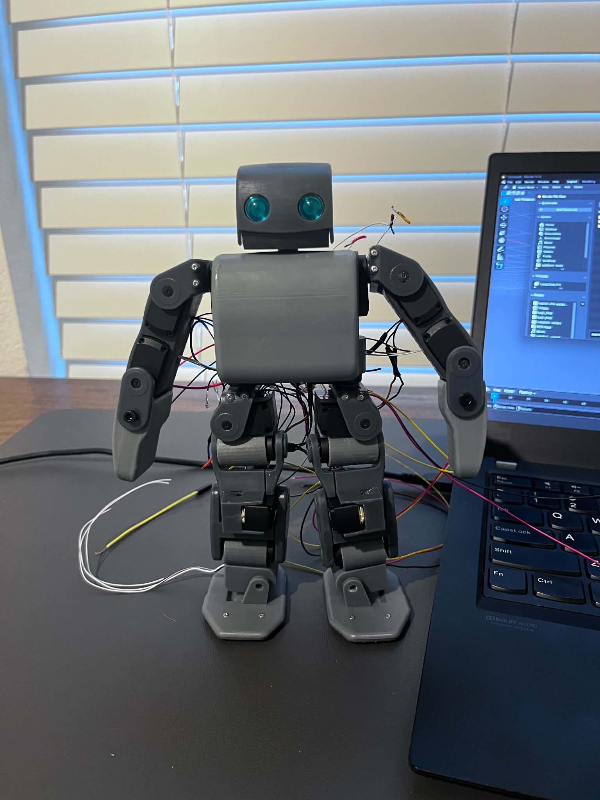

# Mini PLEN: RoBoHoN Servos

A 3D-printed mini PLEN humanoid driven by actuators salvaged from Sharp RoBoHoN
(SR01M) robots, with ESP32 firmware that speaks RoBoHoN's serial servo buses
directly, a browser motion editor, and a browser controller.

> Work in progress. CAD is not published yet; the parts are being decimated
> and cleaned up first.

## Where it started, where it is going

The project began by reverse-engineering RoBoHoN's servo buses with a logic
analyzer and driving a stock RoBoHoN from an ESP32-C3 with its Android board
removed. The same firmware, motion editor and control app are now being
carried over to the mini PLEN:

- 3D-printed PLEN-style body sized for RoBoHoN actuators
- 19 RoBoHoN servos
- ESP32-S3 controller
- 4 servo buses (two RoBoHoN donors' leg buses, plus arm/head buses)

## Repository layout

| Folder | What it is |
|---|---|
| `firmware/RobohonFirmware/` | ESP32 firmware: servo buses, Wi-Fi WebSocket and BLE control, motion playback and on-board motion storage (LittleFS) |
| `firmware/tools/` | Bench tools: `NeckJog2` and `HeadServoTest` single-servo testers, range-finder scripts, logic-analyzer packet analyzer and packetizer |
| `firmware/hand/stepper_test/` | Robot hand actuator test (ESP32-C3 + DRV8825 micro stepper slider) |
| `motion-editor/Anim8/` | RoBoHoN Motion Editor: Anim8, a Three.js motion editor, adapted to drive RoBoHoN servos over Wi-Fi or USB Web Serial |
| `connect-app/` | RoBoHoN Connect App: browser interface to upload motion files and control the robot; being grown into the mini PLEN controller |
| `motions/` | Example motion files |
| `protocol-captures/` | Logic-analyzer captures and decoded packets from a stock RoBoHoN |
| `docs/` | Protocol notes, captured home frames, servo numbering reference |

## RoBoHoN servo bus

- 115200 baud, 8N1, single half-duplex data wire, idle high, 3.7 V servo supply.
- 30-byte frames: `77 80 00 03 06 00`, five 4-byte slots `[pos_lo pos_hi flag sid]`,
  a 3-byte trailer channel (a sixth servo on the leg bus), then a checksum
  `(256 - sum(bytes 6..28)) & 0xFF`.
- Flag `0x40` moves or holds a servo; `0xFF` relaxes it.
- Stock RoBoHoN buses: leg (6 servos), head/elbow (5), shoulder (2).

| Bus | Current ESP32 pin |
|---|---|
| Leg | GPIO 4 (UART1 TX) |
| Shoulder | GPIO 5 (bit-bang TX) |
| Head / elbow | GPIO 6 (bit-bang TX) |

Captured home frames, the two-stage relax sequence and measured range limits
are in `docs/IMPORTANT NOTES.txt` and `docs/COMMAND STRUCTURE.txt`.

## Getting started

**Firmware** (Arduino IDE, ESP32 Arduino core):

1. Install libraries: ESPAsyncWebServer (mathieucarbou fork) and its AsyncTCP,
   ArduinoJson, Adafruit NeoPixel.
2. In `firmware/RobohonFirmware/`, copy `secrets.example.h` to `secrets.h` and
   enter your Wi-Fi networks. `secrets.h` is git-ignored.
3. Open `RobohonFirmware.ino`, select your ESP32 board and upload. The board
   prints its IP address in the Serial Monitor.

**Motion editor and Connect App:** run `launch.bat` in the app's folder (it
serves the folder with `python -m http.server 8000`), open
`http://localhost:8000`, and connect to the robot by IP address or USB.

## Credits

- Anim8 is a modern Three.js rewrite of PLEN Project Company's original
  AngularJS motion editor; exported motions use the PLEN 1.4 JSON format.
- [three.js](https://threejs.org/) (MIT) is bundled with the editor.
- RoBoHoN is a trademark of Sharp Corporation. This project is not affiliated
  with Sharp or PLEN Project Company.

## License

MIT. See [LICENSE](LICENSE).
